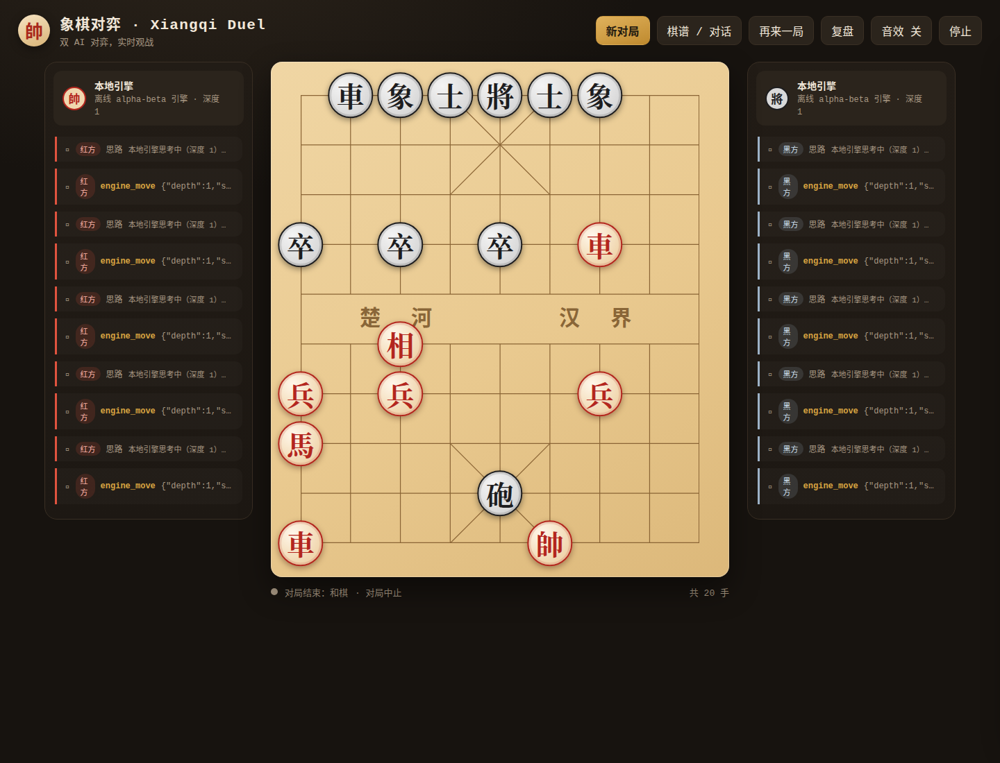
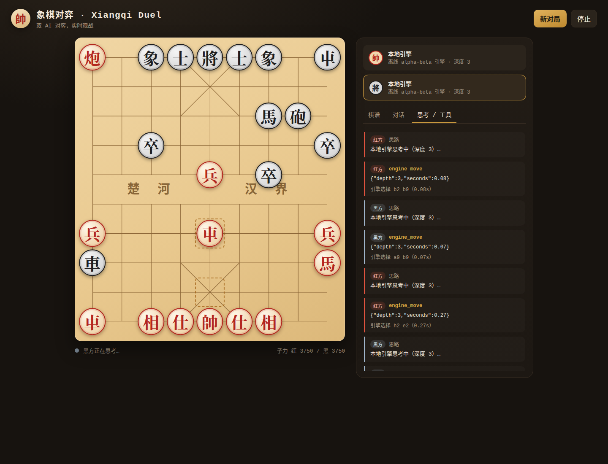
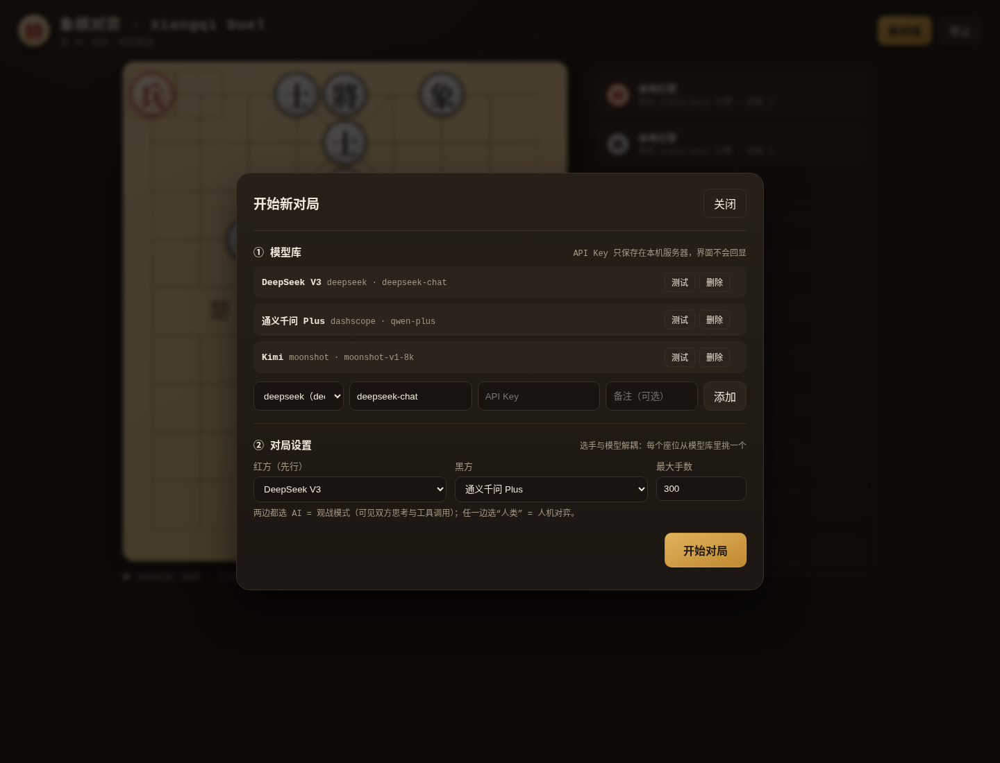

# 象棋对弈 · Xiangqi Duel

> 双 AI 观战 · 人机对弈 · 模型库 · 工具调用


一个完整的中国象棋 AI 对弈软件：内置规则引擎、稳定的棋子编码、11 个 LLM 工具、
可自由切换提供商的模型库，以及一个实时观战网页。

红黑双方各自维护独立上下文，用中文思考、记谱和发言。AI 对 AI 时你能看到每一步的
思路与工具调用；人机对弈时这些内部过程对你隐藏，只保留它公开说的话。







## 特性

- **两种模式**：双 AI 观战（透明展示思考 / 工具调用 / 留言）与人机对弈（隐藏 AI 内部过程）
- **选手与模型解耦**：模型统一登记在本地模型库，开局时给红黑各挑一个，两侧可用不同提供商
- **稳定棋子编码**：`red_horse_1`、`black_advisor_2` 这类编号全局唯一，走子后不变
- **工具接口**：`list_legal_moves(red_horse_1)`、坐标范围查询、格子查询、留言等 11 个工具
- **独立上下文**：每个 AI 只有自己的对话历史，互相不污染
- **中文提示词**：默认中文思考和记谱，避免输出跑成英文
- **AI 留言**：`send_message` 让双方互相喊话；人机模式里你也可以在输入框发言
- **零第三方依赖**：只用 Python 标准库，HTTP / SSE / 回放全部自带的
- **可离线**：内置 alpha-beta 引擎，没有 API Key 也能完整对弈与观战
- **可回放**：一键导出单文件 HTML 回放
- **规则可靠**：走子生成经过 perft 校验，深度 1/2/3 与标准值 44 / 1920 / 79666 一致

## 快速开始

需要 Python 3.9 及以上，没有其他依赖。

```bash
git clone https://github.com/lnrh1/xiangqi-duel.git
cd xiangqi-duel
python3 -m xiangqi_duel.cli serve
```

打开 http://127.0.0.1:8765 ，点「新对局」。

没有任何 API Key 也能玩：红黑两侧都选「本地引擎（离线）」，直接观战。

也可以用 pip 安装：

```bash
pip install -e .
xiangqi-duel serve --port 8765
```

## 添加模型

模型库保存在 `~/.xiangqi-duel/models.json`（权限 600）。密钥不会回显到页面，
也不会写进对局日志。三种添加方式：

1. 网页：新对局 → ① 模型库 → 填提供商 / 模型 / API Key → 添加
2. 命令行：

   ```bash
   xiangqi-duel models add --provider deepseek --model deepseek-chat --api-key sk-xxxx --label "DeepSeek V3"
   xiangqi-duel models list
   xiangqi-duel models test m-xxxxxxxx
   ```

3. 从环境变量导入：

   ```bash
   export DEEPSEEK_API_KEY=sk-xxxx
   export DASHSCOPE_API_KEY=sk-yyyy
   xiangqi-duel models import-env
   ```

内置提供商：

| provider | 协议 | 默认 base_url | 环境变量 |
|---|---|---|---|
| deepseek | OpenAI 兼容 | https://api.deepseek.com/v1 | DEEPSEEK_API_KEY |
| dashscope | OpenAI 兼容（阿里云百炼） | https://dashscope.aliyuncs.com/compatible-mode/v1 | DASHSCOPE_API_KEY |
| openai | OpenAI 兼容 | https://api.openai.com/v1 | OPENAI_API_KEY |
| moonshot | OpenAI 兼容 | https://api.moonshot.cn/v1 | MOONSHOT_API_KEY |
| zhipu | OpenAI 兼容 | https://open.bigmodel.cn/api/paas/v4 | ZHIPU_API_KEY |
| siliconflow | OpenAI 兼容 | https://api.siliconflow.cn/v1 | SILICONFLOW_API_KEY |
| openrouter | OpenAI 兼容 | https://openrouter.ai/api/v1 | OPENROUTER_API_KEY |
| anthropic | Anthropic Messages | https://api.anthropic.com | ANTHROPIC_API_KEY |
| ollama | OpenAI 兼容（本地） | http://127.0.0.1:11434/v1 | — |
| engine | 内置引擎 | — | — |

其他 OpenAI 兼容服务：页面里选「自定义 base_url」，或者

```bash
xiangqi-duel models add --provider custom --model my-model --base-url https://api.example.com/v1 --api-key sk-xxx
```

## 两种对局模式

### AI vs AI（观战）

红黑各选一个模型 → 开始。右侧三个页签：

- **棋谱**：中文记谱与吃子标记
- **对话**：双方用 `send_message` 发出的留言
- **思考 / 工具**：每回合的思考文本和全部工具调用（参数 + 结果）

### 人类 vs AI

把任意一侧选成「人类」。在棋盘上点自己的棋子，绿色圆点是可走位置，再点目标格落子。

对话输入框会把你的话投递给 AI；它可以用 `send_message` 回你，也可以不理你。
人机模式下 AI 的思考与工具调用不会出现在页面上，只显示它公开说的话和对局结果。

## 工具接口

| 工具 | 作用 | 示例参数 |
|---|---|---|
| `get_board` | 棋盘、FEN、轮次、将军、合法着法数 | `{}` |
| `list_pieces` | 列出棋子（编号、x/y、格子名） | `{"color": "red"}` |
| `list_pieces_in_area` | 按 x/y 范围列出棋子 | `{"x_min": 0, "x_max": 2, "y_min": 0, "y_max": 4}` |
| `get_piece` | 单枚棋子的坐标与可走点 | `{"piece_id": "red_horse_1"}` |
| `describe_square` | 单格信息：棋子、九宫、被谁攻击 | `{"square": "h2"}` |
| `list_legal_moves` | 合法着法（可只查一枚棋子） | `{"piece_id": "red_horse_1"}` |
| `move` | 走一步 | `{"piece_id": "red_horse_1", "to": "c2"}` |
| `get_status` | 轮次、结果、重复局面次数、子力 | `{}` |
| `get_history` | 最近的着法与留言 | `{"last": 8}` |
| `send_message` | 给对手留言（每局 6 条，每条 80 字） | `{"text": "承让"}` |
| `resign` | 认输 | `{"reason": "无路可走"}` |

坐标：file `a-i` 是列，rank `0-9` 是行；`a0` 是红方左下角，`y=0` 是红方底线。

## 棋子编码

编号格式为 `颜色_兵种_序号`，序号按列 `a → i` 排列，红黑两侧规则一致：

| 红方 | 黑方 |
|---|---|
| red_chariot_1 / red_chariot_2 | black_chariot_1 / black_chariot_2 |
| red_horse_1 / red_horse_2 | black_horse_1 / black_horse_2 |
| red_elephant_1 / red_elephant_2 | black_elephant_1 / black_elephant_2 |
| red_advisor_1 / red_advisor_2 | black_advisor_1 / black_advisor_2 |
| red_general | black_general |
| red_cannon_1 / red_cannon_2 | black_cannon_1 / black_cannon_2 |
| red_soldier_1 … red_soldier_5 | black_soldier_1 … black_soldier_5 |

也接受别名：`红马1`、`redhorse1`、`horse_1`（当前行棋方）、`rook_2` 等。

## 规则

- 车走直线；马走日、蹩马腿；炮走直线、吃子须隔一子；象走田、不过河；
  士与将限九宫；将帅不能照面
- 兵卒过河前只能前进，过河后可横走
- 判负：被将死、无子可走（困毙）、长将
- 判和：三次重复局面、60 回合无吃子、双方均无进攻子力
- perft 校验：44 / 1920 / 79666

简化说明：完整的 WXF 长捉 / 一将一捉细则没有实现，重复局面用「三次重复 + 长将」近似判定。

## 部署

默认只监听 `127.0.0.1`，用 SSH 隧道或 nginx + Basic Auth 访问；
systemd 常驻、反代配置与安全注意事项见 [docs/DEPLOY.md](docs/DEPLOY.md)。

## 命令行

```bash
xiangqi-duel serve --port 8765
xiangqi-duel play --red engine --black engine --depth 3 --max-plies 200 --out games/a.json
xiangqi-duel play --red model:m-xxxxxxxx --black model:m-yyyyyyyy
xiangqi-duel play --red human --black engine --depth 2
xiangqi-duel replay games/a.json --html a.html --text
xiangqi-duel models list | add | remove | test | import-env
xiangqi-duel start
xiangqi-duel selftest
```

## HTTP API

| 方法 | 路径 | 说明 |
|---|---|---|
| GET | / | 观战 / 对弈页面 |
| GET | /api/state | 当前对局快照 |
| GET | /api/events | SSE 事件流 |
| GET | /api/models | 模型库（不含密钥） |
| POST | /api/models | 添加模型 |
| DELETE | /api/models/{id} | 删除模型 |
| POST | /api/models/{id}/test | 连通性测试 |
| POST | /api/new | 开始对局 |
| POST | /api/move | 人类走子 |
| POST | /api/say | 人类发言 |
| POST | /api/stop | 终止对局 |
| GET | /api/log | 当前对局的完整日志 |

## 项目结构

```
xiangqi_duel/
  coords.py       坐标、九宫、河界的判定
  pieces.py       棋子、编号、别名
  board.py        棋盘、FEN、ASCII 渲染
  moves.py        走子生成、攻击判定、perft
  notation.py     中文记谱
  game.py         对局状态、判负与判和
  tools.py        11 个 LLM 工具的定义与执行
  llm.py          OpenAI 兼容 / Anthropic 客户端
  agent.py        LLM 棋手（独立上下文）与本地引擎棋手
  arena.py        对局编排、事件流、留言
  server.py       HTTP + SSE 服务
  models.py       本地模型库
  viewer.py       单文件 HTML 回放
  cli.py          命令行入口
  web/index.html  前端（单文件，无构建）
tests/            82 个单元 / 集成测试
examples/         示例对局与离线回放
```

## 测试

```bash
python3 -m unittest discover -s tests -v
```

覆盖规则与 perft、记谱、工具、引擎、代理循环（含非法着法重试与兜底）、
模型库、对局编排与 HTTP 接口。

## 示例对局

`examples/demo-game.json` 是内置引擎自战 93 手的完整日志（三次重复判和），
`examples/demo-replay.html` 是导出的离线回放页面，双击即可查看。

## English

Xiangqi Duel is a dependency-free Chinese chess game built for LLM agents. Two AIs
(from any OpenAI-compatible or Anthropic provider) play each other with eleven
tool calls such as `list_legal_moves("red_horse_1")` and `move(...)`;
each side keeps its own conversation context and can chat with the opponent via
`send_message`. A spectator page shows every thought and tool call, while
human-vs-AI mode hides the AI's internal reasoning. Models live in a local registry,
so players and providers stay decoupled. An offline alpha-beta engine makes the whole
pipeline runnable without any API key.

## License

MIT © 2026 lnrh1
