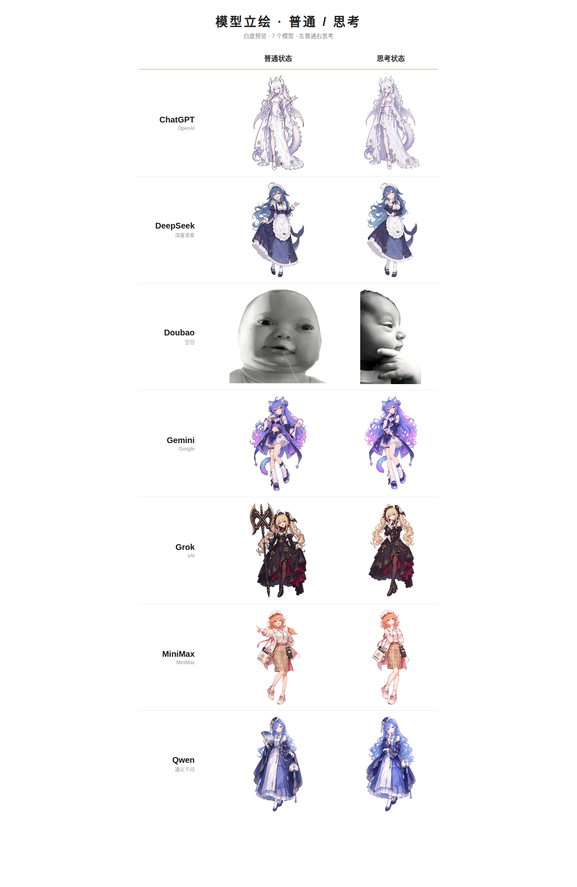

# 象棋对弈 · Xiangqi Duel


双 AI 观战 / 人机对弈的中国象棋，面向 LLM 智能体设计：模型自主思考、调用工具、互相留言；
你可以观战、亲自下场，或复盘整局。


## 特性

- **首页与选人**：主页 → 选择模式 → 两侧点选棋手 → 开局；设置页管理模型库、工具开关和外观
- **两种对局**：AI 对战 AI（双方思考、工具调用、留言全部可见），以及对战 AI（AI 内部过程对你隐藏）
- **自由模式**：不设回合限制，双方棋子都能走，适合摆局面、试招或录制演示
- **求和**：人机模式人类点「求和」立即和棋；AI 对 AI 必须双方都同意
- **终局对话**：模型对局结束后，胜者或和棋发起方先说，双方各 3 条、共 6 条；用户主动求和则不触发
- **棋手与模型解耦**：模型统一存在本地模型库，填 base_url / Key 后可「获取模型」下拉选择，红黑各挑一个
- **稳定棋子编码**：`red_horse_1`、`black_advisor_2` 全局唯一，走子后编号不变
- **14 个工具**：查询棋子、合法着法、格子攻防、局面状态、留言、和棋提议、备忘、认输；可在设置里逐个开关（`move` 必选）
- **独立上下文**：每个 AI 只有自己的对话历史，互不污染；默认中文提示词与中文记谱
- **流式思考**：思考内容逐字推送；思考和工具调用默认折叠，点开看全文
- **不限步数**：模型可以反复查询、思考到满意再落子；没有「停止」按钮，对局只能下完或和棋结束
- **模型立绘**：内置 7 套立绘，可在设置里开关；仅 AI 对战 AI 显示立绘（人机模式不显示）；点击立绘显示一行 token 统计（3 秒后自动消失）
- **棋谱交互**：鼠标在棋谱某一行停留 1 秒，棋盘上重放这一手；悬停时循环，移开播完即止
- **复盘**：终局后可从头逐步回放，一步 = 一方的一整个回合（思考、工具、留言一起放出）
- **再来一局**：保留双方模型与设置，直接开下一盘
- **离线可用**：内置 alpha-beta 引擎，没有 API Key 也能完整对弈
- **零第三方依赖**：仅 Python 标准库，HTTP / SSE / 回放全部自带
- **规则可靠**：走子生成通过 perft 校验，深度 1/2/3 为 44 / 1920 / 79666
- **音效**：落子、吃子、将军、终局与立绘点击都有代码合成的音效，可一键关闭

## 快速开始

需要 Python 3.9 及以上，没有其他依赖。

```bash
git clone https://github.com/lnrh1/xiangqi-duel.git
cd xiangqi-duel
python3 -m xiangqi_duel.cli serve
```

打开 http://127.0.0.1:8765 ，点「新对局」。没有 API Key 也能玩：
两侧都选「本地引擎（离线）」即可观战。

也可以用 pip 安装：

```bash
pip install -e .
xiangqi-duel serve --port 8765
```

## 添加模型

模型库保存在 `~/.xiangqi-duel/models.json`（权限 600）。密钥不会回显到页面，
也不会写进对局日志。

1. 网页：设置 → 模型库，填提供商 / 模型 / API Key，点「获取模型」拉取列表后选择
2. 命令行：

   ```bash
   xiangqi-duel models add --provider deepseek --model deepseek-chat --api-key sk-xxxx --label "DeepSeek V3"
   xiangqi-duel models list
   xiangqi-duel models test m-xxxxxxxx
   ```

3. 从环境变量导入：

   ```bash
   export DEEPSEEK_API_KEY=sk-xxxx
   export DASHSCOPE_API_KEY=sk-yyyy
   xiangqi-duel models import-env
   ```

内置提供商：

| provider | 协议 | 默认 base_url | 环境变量 |
|---|---|---|---|
| deepseek | OpenAI 兼容 | https://api.deepseek.com/v1 | DEEPSEEK_API_KEY |
| dashscope | OpenAI 兼容（阿里云百炼） | https://dashscope.aliyuncs.com/compatible-mode/v1 | DASHSCOPE_API_KEY |
| openai | OpenAI 兼容 | https://api.openai.com/v1 | OPENAI_API_KEY |
| moonshot | OpenAI 兼容 | https://api.moonshot.cn/v1 | MOONSHOT_API_KEY |
| zhipu | OpenAI 兼容 | https://open.bigmodel.cn/api/paas/v4 | ZHIPU_API_KEY |
| siliconflow | OpenAI 兼容 | https://api.siliconflow.cn/v1 | SILICONFLOW_API_KEY |
| openrouter | OpenAI 兼容 | https://openrouter.ai/api/v1 | OPENROUTER_API_KEY |
| anthropic | Anthropic Messages | https://api.anthropic.com | ANTHROPIC_API_KEY |
| ollama | OpenAI 兼容（本地） | http://127.0.0.1:11434/v1 | — |
| engine | 内置引擎 | — | — |

其他 OpenAI 兼容服务选「自定义 base_url」，或：

```bash
xiangqi-duel models add --provider custom --model my-model --base-url https://api.example.com/v1 --api-key sk-xxx
```

## 对局模式

### AI 对战 AI

双方各选一个模型。棋盘居中，红方思考在左、黑方思考在右，各自实时显示思考、工具调用与留言；
棋谱 / 对话收在顶部抽屉里，不占版面。没有 API Key 时两边都选本地引擎即可。
观战者也可以在「对话」里以观众身份留言，双方 AI 下一回合会读到，适合在僵持局提醒它们。

### 人机对弈

两侧都可以选「我（人类）」，先选 AI 的一边也可以——另一边会自动变成你，因此红黑都能执。
在棋盘上点自己的棋子：绿色圆点可走，红色圆点可吃，再点目标格落子。

右侧是棋手、棋谱 / 对话和聊天输入框；AI 的思考与工具调用不会出现在页面上，只显示它公开说的话。
AI 的立绘显示在侧栏下方，思考时切换状态；点击立绘可查看 token 统计。

### 自由模式

不设回合限制，点任意一方的棋子都能走；一方被将死（绝杀）或困毙时对局立即结束。没有 AI、聊天和推演按钮，只有棋盘与棋谱。
适合摆局面、试招，或者录制宣传素材。从首页的「自由模式」进入。

## 模型立绘

内置 7 套立绘（ChatGPT / DeepSeek / 豆包 / Gemini / Grok / MiniMax / Qwen），
素材在 `xiangqi_duel/web/art/`，可在设置 → 外观里关闭。

- 选人时，选中模型的一侧显示普通状态立绘，黑方镜像翻转
- 对局中轮到它思考、调用工具或输出时，自动切换为思考状态
- 点击立绘会弹一下并播放提示音，同时显示一行 token：总输入 / 缓存命中 / 总输出 / 当前上下文，3 秒后消失
- 模型名匹配忽略大小写和符号，只按字母比对（`DeepSeek-V3`、`deepseek_flash`、`Deep Seek` 都能识别）



## 棋谱、悬停与复盘

- 棋谱用中文记谱，吃子带「吃」标记，双方留言会附在对应手数后
- 鼠标停在棋谱某一行 1 秒，棋盘会重放这一手；悬停时循环播放，移开则当前动画播完停止
- 终局后点「复盘」：从开局开始，按「下一步」推进；一步是「对方落子完 → 这一方落子」的一整段，
  思考、工具调用、留言一起放出；点棋谱任意一手可直接跳转，键盘 ← → 也能切换
- 终局后双方 AI 会各说一句道别

## 推演棋盘

开启后可以在一块虚拟棋盘上试走，红黑轮流走（双方棋子都能操作），最多 8 步（含双方），到上限或手动退出后回到真实对局。

- **AI**：工具列表里的 `start_simulation` / `end_simulation`。推演期间的 `move`、`list_legal_moves`、`get_status` 等会自动切到虚拟棋盘，不会影响真实棋局；`list_legal_moves` 会额外给出每步能吃哪个子、是否将军，但不会提示是否绝杀。AI 推演时观战界面会同步显示虚拟棋盘。
- **人类**：只有处于人机模式、且本局启用了 `start_simulation` 工具时，右侧才会出现「进入推演」按钮；点击后按钮变为「退出推演」，在真实棋盘上直接走虚拟子（红黑轮流走），最多 8 步；人机模式下 AI 的推演对你不可见。
- 推演棋盘只在当前对局内有效，真实落子或退出后即清空。

> **注意**：如果启用推演棋盘工具，AI 可能反复推演，导致一局的时间被严重拖长。可以在设置 → 工具开关里关掉它；关闭后该工具不会出现在模型的工具列表中。

## 导出视频

对局结束后，顶部会出现「导出视频」：

- 只包含棋局、走子动画、将军提示和终局特效，不再包含思考与工具
- 视频最长 5 分钟；手数多时会自动压缩每手时长，短局则保持正常节奏
- 画布提升到 1920×1140、10 Mbps，比原来的 1280×760 更清晰
- 渲染过程中显示进度，完成后可在弹窗内预览，并点击「下载视频」保存为 `.webm`
- 依赖浏览器的 MediaRecorder（Chrome / Edge），导出视频目前不含声音

## 求和与终局对话

- 人机模式：人类点顶部「求和」立即和棋；AI 提议和棋时，人类也可以点「求和」同意
- AI 对 AI：一方 `offer_draw` 后，另一方也调用 `offer_draw` 才算双方同意，随即和棋
- 终局对话只在 AI 对 AI 结束后触发，用户主动求和不触发
- 对话由胜者开始；和棋时由提出和棋的一方开始，自动和棋则由红方开始
- 双方各 3 条、共 6 条，交替发言；每条提示都会告诉模型还剩几条
- 最后一条发送后，系统仍会再调用一次发起方，但只读、不回复；下一局开始前不会再有新回信

## 工具接口

共 14 个工具，可在设置里逐个开关（`move` 必选）。关闭的工具不会出现在模型工具列表中。

| 工具 | 作用 | 示例参数 |
|---|---|---|
| `list_pieces` | 列出棋子及编号、类型、位置 | `{"color": "red"}` |
| `get_piece` | 单枚棋子的位置与可走点位 | `{"piece_id": "red_horse_1"}` |
| `list_legal_moves` | 一枚棋子或全部棋子的合法着法 | `{"piece_id": "red_cannon_1"}` |
| `move` | 走一步棋（回合结束时统一执行） | `{"piece_id": "red_horse_1", "to": "3-3"}` |
| `get_status` | 轮次、状态、结果、将军、手数、重复局面、子力 | `{}` |
| `send_message` | 给对手留言（每局 6 条，每条 80 字） | `{"text": "承让"}` |
| `start_simulation` | 进入推演棋盘（虚拟对局，最多 8 步） | `{}` |
| `end_simulation` | 退出推演，回到真实棋盘 | `{}` |
| `offer_draw` | 提议和棋，附一句 note；对手也提议即双方同意 | `{"note": "局面均势"}` |
| `note` | 给自己记备忘，后续回合出现在提示里 | `{"text": "防他马八进七"}` |
| `resign` | 认输 | `{"reason": "无路可走"}` |
| `define_tool` | 定义当前对局专用的组合工具；参数可用花括号占位传给子工具；不能包含 define_tool | `{"name":"get_information","steps":[{"tool":"list_pieces"},{"tool":"get_status"}]}` |
| `list_pieces_in_area` | 按坐标范围列出棋子 | `{"x_min": 1, "x_max": 5, "y_min": 1, "y_max": 5}` |
| `describe_square` | 单格信息：棋子、九宫、被哪方攻击 | `{"square": "8-2"}` |

define_tool 定义的自定义工具属于该 AI；开新对局会清空，「再来一局」会保留。

## 棋子编码

- 红方：`red_chariot_1`、`red_horse_1`、`red_elephant_1`、`red_advisor_1`、`red_general`、`red_cannon_1`、`red_soldier_1`
- 黑方：`black_chariot_1`、`black_horse_1`、`black_elephant_1`、`black_advisor_1`、`black_general`、`black_cannon_1`、`black_soldier_1`
- 同类多枚按纵线 a→i 编号；编号在对局中不变
- 兼容别名：`红马1`、`redhorse1`、`horse_1`（当前方）等

坐标写成 `列-行` 的纯数字：列 1–9，行 1–10；`1-1` 是红方左下角，`9-10` 是黑方右上角。
中文记谱如「马八进七」；查询范围时 x 用 1–9、y 用 1–10。

## 规则

- 车走直线；马走日、蹩马腿；炮走直线、吃子须隔一子；象走田、不过河；士与将限九宫；将帅不能照面
- 兵卒过河前只能前进，过河后可横走
- 判负：被将死、无子可走（困毙）、长将；判和：三次重复、60 回合无吃子、双方均无进攻子力
- 简化说明：完整的 WXF 长捉 / 一将一捉细则没有实现，重复局面用「三次重复 + 长将」近似判定
- perft：44 / 1920 / 79666

## 部署

默认只监听 `127.0.0.1`。公网部署建议 nginx + Basic Auth 或 SSH 隧道；
systemd 常驻、反向代理与安全注意事项见 [docs/DEPLOY.md](docs/DEPLOY.md)。

## 命令行

```bash
xiangqi-duel serve --port 8765
xiangqi-duel play --red engine --black engine --depth 3 --max-plies 200 --out games/a.json
xiangqi-duel play --red model:m-xxxxxxxx --black model:m-yyyyyyyy
xiangqi-duel play --red human --black engine --depth 2
xiangqi-duel replay games/a.json --html a.html --text
xiangqi-duel models list | add | remove | test | import-env
xiangqi-duel start
xiangqi-duel selftest
```

## HTTP API

| 方法 | 路径 | 说明 |
|---|---|---|
| GET | / | 观战 / 对弈页面 |
| GET | /api/state | 当前对局快照 |
| GET | /api/events | SSE 事件流 |
| GET | /api/tools | 工具列表（设置页用） |
| GET | /api/models | 模型库（不含密钥） |
| POST | /api/models | 添加模型 |
| DELETE | /api/models/{id} | 删除模型 |
| POST | /api/models/{id}/test | 连通性测试 |
| GET | /api/models/discover | 按 base_url / Key 拉取模型列表 |
| POST | /api/new | 开始对局（mode=free 进入自由模式） |
| POST | /api/move | 人类走子 |
| POST | /api/free/move | 自由模式走子（任意一方） |
| POST | /api/say | 人类发言 |
| POST | /api/resign | 人类认输 |
| POST | /api/draw | 人类求和（立即和棋） |
| POST | /api/rematch | 再来一局 |
| POST | /api/stop | 内部使用，页面已移除停止按钮 |
| GET | /api/log | 当前对局完整日志 |

## 项目结构

```
xiangqi_duel/
  coords.py       坐标、九宫、河界判定
  pieces.py       棋子、编号、别名
  board.py        棋盘、FEN、ASCII 渲染
  moves.py        走子生成、攻击判定、perft
  notation.py     中文记谱
  game.py         对局状态、判负与判和
  tools.py        13 个 LLM 工具
  llm.py          OpenAI 兼容 / Anthropic 客户端
  agent.py        LLM 棋手（独立上下文）与本地引擎棋手
  arena.py        对局编排、事件流、留言、和棋
  server.py       HTTP + SSE 服务
  models.py       本地模型库
  viewer.py       单文件 HTML 回放
  cli.py          命令行入口
  web/index.html  前端（单文件，无构建）
  web/art/        模型立绘素材
tests/            92 个单元 / 集成测试
examples/         示例对局与离线回放
```

## 测试

```bash
python3 -m unittest discover -s tests -v
```

覆盖规则与 perft、记谱、工具、引擎、代理循环、模型库、对局编排与 HTTP 接口。
CI 配置在 [docs/ci-workflow.yml](docs/ci-workflow.yml)，复制到 `.github/workflows/ci.yml` 即可启用。

## 示例对局

- `examples/demo-game.json`：内置引擎自战 93 手（三次重复判和）及对应回放
- `examples/deepseek-game.json`：真实 DeepSeek 自战 24 手，含中文思考与全部工具调用及回放

## English

Xiangqi Duel is a dependency-free Chinese chess game built for LLM agents. Two AIs
(any OpenAI-compatible or Anthropic provider) play each other with thirteen tools such as
`list_legal_moves("red_horse_1")` and `move(...)`; each side keeps its own context and
can chat with the opponent via `send_message`. A spectator page shows every thought and
tool call, while human-vs-AI hides the AI's internal reasoning. Models live in a local
registry, and an offline alpha-beta engine makes the whole pipeline runnable without any
API key. Model illustrations can be enabled in settings and switch to a thinking pose
while the model is working.

## License

MIT © 2026 lnrh1
